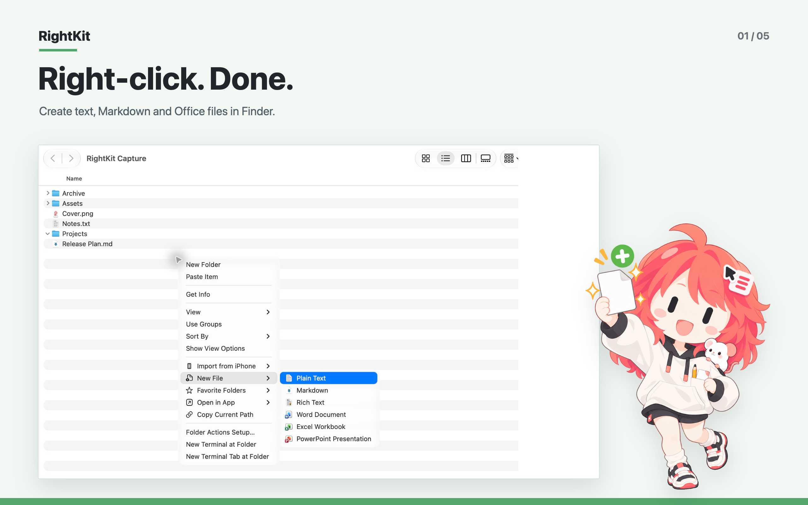
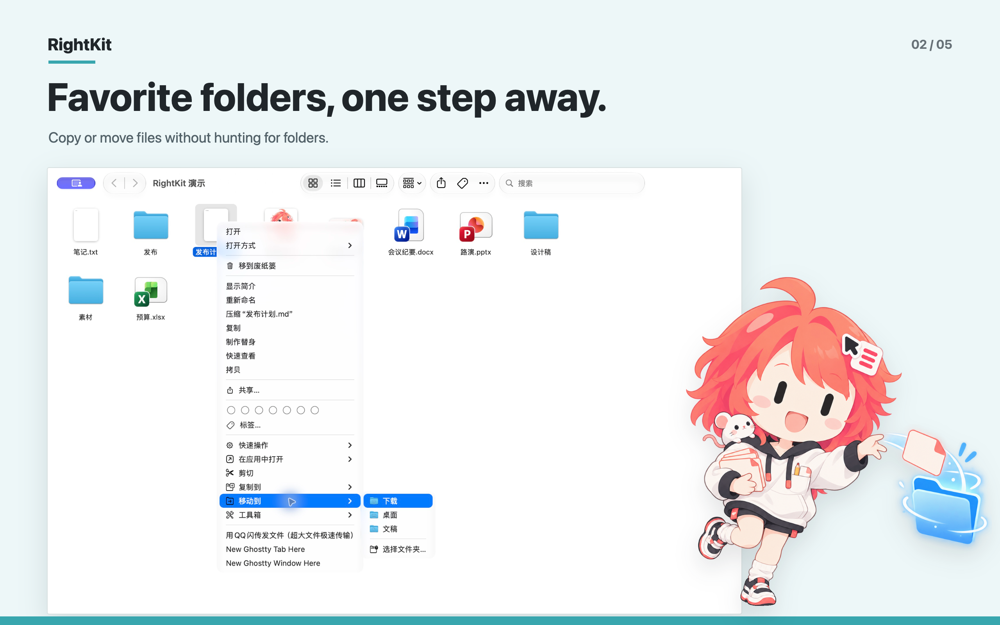
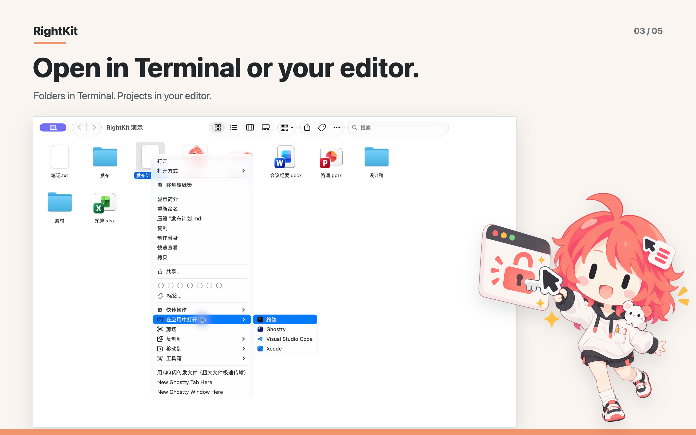
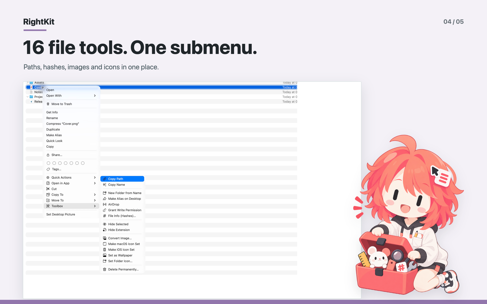
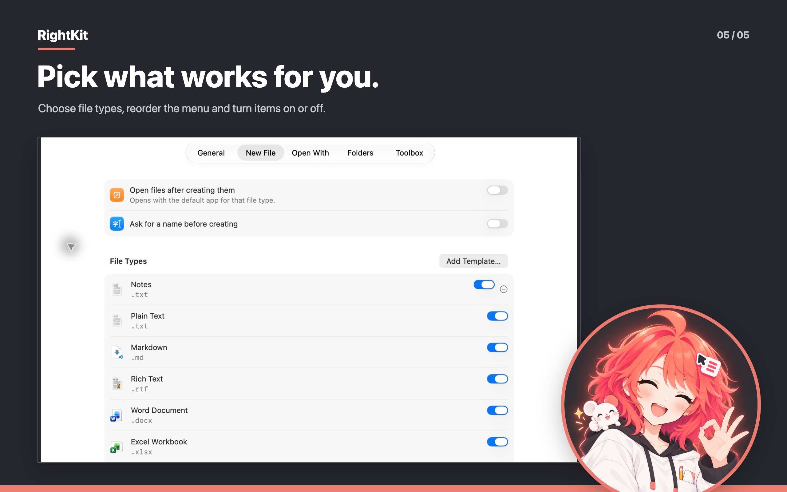
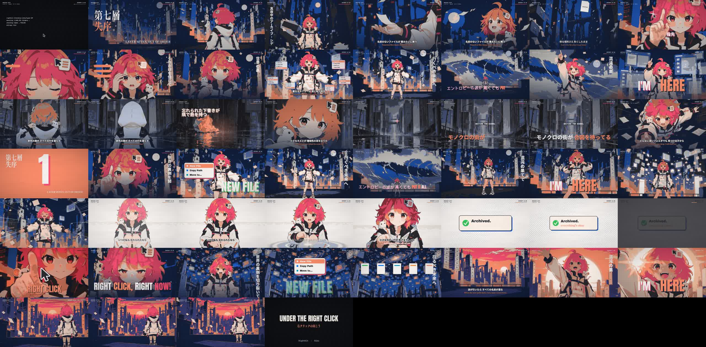

<div align="center">


# RightKit

**macOS Finder를 위한 강력한 우클릭 도구 상자. 우클릭 한 번이면 끝.**

가볍고, 네이티브하며, 군더더기 없는 경험. 최신 SwiftUI와 경량 시스템 확장 프로그램으로 구축된 Finder 단축 메뉴 확장 도구입니다.

<p>
  <a href="README.md">简体中文</a> •
  <a href="README.en.md">English</a> •
  <a href="README.ja.md">日本語</a> •
  <a href="README.ko.md"><strong>한국어</strong></a>
</p>

[](https://rightkit.yiliang.app/ko/)
[](https://swift.org)
[](https://apps.apple.com/app/id6816212746)
[](https://github.com/AquaHydro/rightkit/releases/latest)
[](LICENSE)
[](docs/technical.md)

[공식 웹사이트](https://rightkit.yiliang.app/ko/) · [Mac App Store 구매](https://apps.apple.com/app/id6816212746) · [공식 웹사이트 DMG 다운로드](https://github.com/AquaHydro/rightkit/releases/latest) · [기능 사양](docs/features.md) · [디자인 가이드라인](DESIGN.md) · [기술 아키텍처](docs/technical.md)

</div>

---

<p align="center">
  
</p>

## 💡 왜 RightKit인가요?

macOS의 Finder는 단순하고 깔끔하지만, 일상적인 반복 작업에서는 불편함이 따릅니다. 새 텍스트나 스프레드시트 문서를 만들려면 먼저 해당 앱을 실행해야 하고, 터미널에서 작업하려면 경로를 복사해 `cd`를 입력해야 하며, 파일을 정리할 때 여러 창을 나란히 띄워야 하고, 체크섬 확인이나 이미지 변환을 위해 별도 유틸리티를 찾아야 합니다.

**RightKit**은 이러한 빈번한 작업들을 마우스 우클릭 메뉴 안으로 자연스럽게 통합합니다.

- **완벽한 네이티브 일체감**: Apple의 Human Interface Guidelines를 준수하며, 불필요한 장식 없이 Finder와 완벽하게 어우러집니다.
- **밀리초 단위의 즉각적인 반응**: 메인 앱과 Finder 확장 프로그램을 분리한 경량 설계. 백그라운드 사전 예열과 비트맵 캐싱을 통해 우클릭 메뉴가 지연 없이 매끄럽게 나타납니다.
- **상황 맞춤형 지능형 표시**: 선택한 대상(빈 공간, 단일 파일, 폴더 그룹, 이미지)을 자동으로 감지하여 지금 필요한 명령만 스마트하게 조합합니다.
- **철저한 샌드박스와 오프라인 안전성**: 100% App Sandbox 내부에서 실행되며 사용자가 명시적으로 허용한 감시 폴더에만 접근합니다. 외부 통신이나 데이터 수집이 전혀 없습니다.
- **시스템 핵심 경로 삭제 방지**: 완전 삭제 시 확인 대화상자가 표시되며 루트 `/`, 사용자 홈 폴더, 주요 시스템 폴더는 보호 대상으로 지정되어 실수로 삭제되지 않습니다.

---

## ✨ 핵심 기능

### 1. 새 파일 (New File)

우클릭한 바로 그 자리에서 필요한 문서를 즉시 생성합니다.

- **12가지 기본 형식 내장**: 일반 텍스트(.txt), Markdown(.md), 서식 있는 텍스트(.rtf), Word(.docx), Excel(.xlsx), PowerPoint(.pptx), JSON, XML, HTML, CSS, JavaScript, 셸 스크립트(.sh).
- **사용자 정의 템플릿**: 자주 쓰는 문서 양식을 템플릿 목록에 추가하면 생성 시 완전한 복사본을 즉시 복제합니다.
- **동일 이름 자동 번호 매김**: 대상 폴더에 같은 이름이 있으면 자동으로 번호를 부여(예: `이름 없음 2.docx`)하여 기존 파일을 덮어쓰지 않습니다.
- **유연한 설정 옵션**: '생성 전 파일 이름 묻기' 및 '생성 후 기본 앱으로 자동 열기' 기능을 선택할 수 있습니다.

<p align="center">
  
</p>

### 2. 잘라내기, 복사 위치, 이동 위치 (Cut, Copy & Move)

macOS Finder에서 직관적인 잘라내기와 빠른 파일 이동 환경을 제공합니다.

- **우클릭 잘라내기 및 붙여넣기**: 항목을 선택해 '잘라내기'를 실행한 후 대상 폴더에서 '붙여넣기'하면 즉시 이동됩니다. 독립 대기열을 사용하여 시스템 클립보드를 침범하지 않습니다.
- **보낼 위치 프리셋**: 자주 사용하는 대상 폴더를 등록해 두면 하위 메뉴에서 한 번에 '복사 위치' 또는 '이동 위치'로 전송합니다.
- **자주 사용하는 폴더 바로 열기**: 폴더의 빈 공간에서 우클릭하여 등록된 즐겨찾기 폴더로 빠르게 이동합니다.
- **네이티브 진행 상황 창**: 대용량 파일이나 다수의 항목 처리 시 1초를 초과하면 진행 상황 창이 표시되며 안전하게 취소할 수 있습니다.

<p align="center">
  
</p>

### 3. 앱으로 열기 (Open in App)

개발자, 디자이너, 생산성을 중시하는 사용자를 위한 최적의 연동 도구입니다.

- **상황별 스마트 실행**: 파일을 선택하면 편집기에서 열리고, 폴더를 선택하면 터미널이 해당 디렉토리를 작업 경로로 하여 열립니다.
- **주요 도구 자동 감지**: 터미널(Terminal), Ghostty, Visual Studio Code, Xcode를 자동으로 찾으며, Mac에 설치된 임의의 `.app`도 등록할 수 있습니다.
- **안전한 실행 방식**: 시스템 Workspace API를 직접 호출하며, 셸 명령어 문자열 조합을 사용하지 않아 안전합니다.

<p align="center">
  
</p>

### 4. 파일 도구 16가지 (Toolbox)

일상적인 파일 관리에 유용한 16가지 도구를 갖추고 있으며, 설정에서 개별 활성화 및 그룹 내 순서 변경이 가능합니다:

| 그룹 | 명령 | 설명 |
| --- | --- | --- |
| **경로 및 이름** | 경로 복사, 이름 복사 | POSIX 경로 또는 표시 이름을 복사합니다. 빈 공간에서는 '현재 경로 복사' 지원 |
| **정리 및 공유** | 이름으로 폴더 만들기 | 파일 이름과 동일한 폴더를 생성하고 해당 파일을 그 안으로 깔끔하게 이동 |
| | 데스크탑에 가상본 만들기 | 선택한 항목의 가상본을 바탕화면에 즉시 생성 |
| | AirDrop | 시스템 기본 AirDrop 공유 시트를 호출하여 선택 항목을 한 번에 전송 |
| | 쓰기 권한 부여 | 현재 사용자에게 선택 항목에 대한 쓰기 권한 부여 (소유자 변경 없음, 비재귀적) |
| | 파일 정보(해시) | MD5, SHA-1, SHA-256, SHA-512 체크섬을 로컬에서 스트리밍 계산 |
| **표시 관리** | 선택 항목 숨기기 또는 표시 | 터미널 명령 없이 파일의 숨김 속성을 즉시 전환 |
| | 확장자 숨기기 또는 표시 | Finder 상에서 파일 확장자 표시 여부를 빠르게 전환 |
| **이미지 및 아이콘** | 이미지 변환 | 원본 파일 옆에서 PNG, JPEG, HEIC, TIFF 형식으로 즉시 변환 |
| | macOS 아이콘 세트 만들기 | `.iconset` 폴더 및 표준 `.icns` 파일을 한 번에 생성 |
| | iOS 아이콘 세트 만들기 | 13가지 표준 해상도를 포함하는 iOS 앱 아이콘 폴더 생성 |
| | 배경화면으로 설정, 폴더 아이콘 설정 | 선택한 이미지를 데스크탑 배경화면으로 지정하거나 폴더 아이콘으로 적용 |
| **안전한 폐기** | 폴더 해제 | 폴더 내 하위 항목들을 상위 폴더로 이동시키고 빈 폴더는 휴지통으로 이동 |
| | 완전히 삭제 | 휴지통을 거치지 않고 영구 삭제. 확인 대화상자 및 보호 경로 검사 포함 |

<p align="center">
  
</p>

### 5. 단축 메뉴를 넘어서는 시스템 연동

- **단축어 및 Spotlight 연동**: 새 파일 생성, 해시 계산, 이미지 변환, 아이콘 생성, QR 코드 생성 동작을 시스템 자동화에 활용할 수 있습니다.
- **macOS 시스템 서비스**:
  - **오프라인 QR 코드 생성**: 텍스트를 선택해 기기 내에서 안전하게 고해상도 QR 코드를 생성하고 이미지로 복사하거나 PNG로 저장합니다.
  - **웹 번역 서비스**: 선택한 텍스트를 Google 번역이나 Baidu 번역으로 간편하게 조회합니다.
- **다국어 완벽 지원**: 한국어, 영어, 중국어 간체, 일본어를 기본 지원하며 시스템 언어를 따르거나 앱 설정에서 변경할 수 있습니다.

---

## 📥 다운로드 및 설치

RightKit은 단일 코드베이스에서 두 가지 채널로 제공됩니다:

| 구분 | Mac App Store (스토어 에디션) | 공식 웹사이트 (GitHub Release) |
| --- | --- | --- |
| **다운로드** | [Mac App Store에서 구매](https://apps.apple.com/app/id6816212746) | [GitHub Releases에서 무료 다운로드 (DMG)](https://github.com/AquaHydro/rightkit/releases/latest) |
| **대상 사용자** | App Store에서 통합 관리하고 인디 개발을 후원하고자 하는 사용자 | 오프라인 DMG 설치 및 직접 배포를 선호하는 사용자 |
| **기능** | 모든 기능 완전 동일 | 모든 기능 완전 동일 |
| **업데이트** | Mac App Store를 통해 백그라운드 자동 업데이트 | 앱 내에서 최신 Release를 확인하고 원클릭으로 이동 |
| **샌드박스** | App Sandbox 적용 | App Sandbox 적용 |

### 첫 실행 설정 안내

macOS의 보안 정책에 따라 최초 실행 시 다음 두 단계를 진행해 주세요:

1. **감시 폴더 권한 부여**: RightKit을 실행하고 시작 창이나 설정의 '일반' 탭에서 '개인 폴더 접근 권한 부여'(홈 폴더 권장)를 클릭합니다. RightKit은 허용된 폴더 안에서만 메뉴를 표시합니다.
2. **Finder 확장 프로그램 켜기**: '시스템 설정 → 일반 → 로그인 항목 및 확장 프로그램'으로 이동하여 'Finder 확장 프로그램' 목록에서 RightKit을 활성화합니다.

메인 앱의 '일반' 설정 화면에는 확장 프로그램 상태('활성화됨', '실행되지 않음', '백그라운드 서비스 꺼짐', '비활성화됨')를 보여주는 카드와 시스템 설정 열기 및 Finder 재시동 버튼이 제공됩니다.

<p align="center">
  
</p>

---

## 🛡️ 개인정보 보호 및 보안

1. **엄격한 App Sandbox 준수**: 메인 앱과 확장 프로그램 모두 샌드박스 내에서 실행됩니다. 네트워크 권한은 최소화되어 있습니다 (스토어 버전은 네트워크 권한 없음, 웹사이트 버전은 업데이트 확인을 위한 GitHub API 읽기 전용).
2. **Security-Scoped Bookmarks 사용**: 폴더 접근은 macOS의 보안 범위 책갈피에 전적으로 의존하며, 사용자가 명시적으로 허용하지 않은 외부 경로는 접근할 수 없습니다.
3. **핵심 시스템 경로 삭제 방지**: 루트 `/`, 홈 디렉토리, `/System`, `/Library`, `/usr` 등 핵심 디렉토리에 대해서는 '완전히 삭제' 실행을 원천 차단합니다.
4. **추적 및 분석 코드 배제**: 어떤 분석 SDK나 크래시 트래커도 포함되어 있지 않으며, 사용자의 파일명이나 경로를 외부로 전송하지 않습니다.

---

## 🛠️ 아키텍처 및 엔지니어링

프로젝트는 명확한 4개의 타깃으로 분리되어 관리됩니다:

```text
RightKit (Workspace)
├── RightKit          # SwiftUI 메인 앱: 설정 화면, 시작 창, 확인 대화상자, 파일 I/O 스케줄링, 단축어 및 시스템 서비스 담당
├── RightKitFinder    # 경량 Finder Sync 확장 프로그램: 감시 폴더 관리, 밀리초 단위 단축 메뉴 조립 및 메인 앱으로 명령 전달
├── RightKitAgent     # LaunchAgent 데몬: App Group XPC 서비스를 호스팅하여 메뉴 클릭 시 메인 앱을 안정적으로 실행
└── RightKitCore      # 순수 Swift 로직 패키지: 메뉴 규칙 엔진, 데이터 모델, 보호 경로 판별, 네이밍 알고리즘 (100% 유닛 테스트)
```

### 확장 프로그램 성능 최적화

Finder Sync 확장 프로그램이 부실하게 구현되면 Finder 전체가 멈추는 현상이 발생할 수 있습니다. RightKit은 다음과 같은 최적화를 거쳤습니다:
- **메뉴 콜백 내 무거운 I/O 금지**: 메뉴 생성 콜백 중에는 파일 읽기/쓰기, 해시 계산, 고비용 작업을 절대 수행하지 않습니다.
- **사전 예열(Prewarming)**: 확장 프로그램 시작 및 설정 변경 후 백그라운드에서 미리 메뉴 구조를 구성하여 첫 클릭 시의 딜레이를 제거합니다.
- **16 pt 2x 단일 해상도 비트맵 캐싱**: 프로세스 간 전송되는 아이콘을 16 pt 2x 단일 비트맵으로 규격화하여 시스템의 다중 해상도 직렬화 오버헤드를 방지합니다.

---

## 🔨 로컬 빌드 및 개발

### 요구 사항

- macOS 26 이상
- Xcode 27 이상
- [XcodeGen](https://github.com/yonaskolb/XcodeGen) (`project.yml`을 통해 프로젝트 파일 관리)

### 주요 Make 명령어

```sh
# Xcode 프로젝트 생성, 전체 테스트 실행, 두 채널 빌드 및 명세 검증 수행
make verify

# Debug 타깃 빌드 및 메인 앱 즉시 실행
make run

# 공식 웹사이트 에디션 빌드 (Developer ID 서명, 공증 및 DMG 패키징, .build/release/로 출력)
make release

# 스토어 에디션 빌드 (아카이브, .pkg 내보내기 및 서명 검증, .build/release-appstore/로 출력)
make release-appstore

# 스토어 에디션을 App Store Connect에 업로드
make upload-appstore
```

### 주요 문서 목록

- [기능 사양 (docs/features.md)](docs/features.md): 모든 기능의 동작 규칙, 기본값, 메뉴 표시 조건 및 에러 처리.
- [디자인 가이드라인 (DESIGN.md)](DESIGN.md): 색상, 타이포그래피, 컴포넌트 규격 및 시각적 일관성.
- [기술 아키텍처 (docs/technical.md)](docs/technical.md): 프로세스 분리, App Group IPC, 샌드박스 권한, 릴리스 파이프라인.
- [검증 기준 (docs/verification.md)](docs/verification.md): 테스트 케이스 및 품질 체크리스트.
- [로드맵 (docs/roadmap.md)](docs/roadmap.md): 개발 일정 및 마일스톤.

문서 링크 및 무결성 검사:

```sh
python3 scripts/check_docs.py
```

---

## 🎬 공식 애니메이션 뮤직비디오: 《Under the Right Click》

RightKit의 철학과 비전을 표현하기 위해, 브랜드 마스코트 Riko의 오리지널 90년대 애니메이션 스타일 뮤직비디오 **《Under the Right Click · 右クリックの向こう》**를 제작했습니다 (총 3분 28초, 170 BPM J-rock 애니메이션 오프닝 스타일).

<p align="center">
  <a href="https://www.bilibili.com/video/BV1XnpK6aEut" target="_blank" rel="noopener noreferrer">
    
  </a>
  <br />
  <a href="https://www.bilibili.com/video/BV1XnpK6aEut" target="_blank" rel="noopener noreferrer">
    
  </a>
</p>

### 스토리와 비유: 혼돈의 아카이브 시티

> "허공에 뜬 손끝, 커서가 빛난다. 세 줄의 라인, 그것만을 믿고. 3, 2, 1... Right click! 세상의 이면을 열어라."

수많은 파일 캐비닛으로 이루어진 '아카이브 시티'에 정체불명의 엔트로피 파도가 닥쳐 고층 빌딩이 무너지고 이름 없는 파일들이 눈처럼 흩날립니다. 도시의 정리자인 **Riko**는 우클릭 능력을 통해 '새 파일, 복사, 이동'의 메뉴를 연속해서 펼쳐냅니다. 흩어진 파일들을 제자리로 되돌리고 새벽녘 도시의 엔트로피를 0.0%로 되돌립니다.

폴더가 아무리 복잡하고 어지러워도 우클릭 한 번이면 모든 것이 제자리로 돌아온다는 RightKit의 핵심 가치를 담은 이야기입니다.

### 독창적인 riso-cel 셰이더 렌더링 파이프라인

MV 렌더링에 사용된 전체 파이프라인 코드는 저장소에 포함되어 있습니다:
- **코드로 구현한 레트로 셀 감성**: WebGL 셰이더(Kuwahara 필터, XDoG 윤곽선 지터링, 45도 망점 인쇄 효과, 리소그래프 종이 질감)를 통해 90년대 리소 인쇄 셀 애니메이션 스타일로 프레임마다 재렌더링.
- **파이프라인 오픈소스**: [`mv/under-the-right-click/`](mv/under-the-right-click/README.md)에서 헤드리스 브라우저 렌더러 스크립트, 가사 싱크 타임라인, 전체 [스토리보드 (STORYBOARD.md)](mv/under-the-right-click/STORYBOARD.md)를 확인할 수 있습니다.

<p align="center">
  
</p>

---

## 🎨 브랜드 캐릭터 및 라이선스

RightKit의 브랜드 마스코트는 **Riko**입니다. 코랄색 그라데이션 머리와 바보털, 마우스 커서와 메뉴 모양의 헤어핀이 특징인 밝고 든든한 조수입니다.

- **소스 코드 및 문서**: [MIT 라이선스](LICENSE)에 따라 오픈소스로 공개됩니다.
- **브랜드 자산 보호**: RightKit 명칭, Riko 캐릭터 이미지, 앱 아이콘, 메뉴 막대 아이콘, 오리지널 일러스트, 동영상 등의 자산은 모든 권리가 보유되어 있습니다. 자세한 내용은 [자산 라이선스 안내 (ASSETS.md)](ASSETS.md) 및 [MV 라이선스 고지 (mv/under-the-right-click/NOTICE.md)](mv/under-the-right-click/NOTICE.md)를 참조해 주세요. 오픈소스 라이선스가 브랜드 아트워크의 무단 재사용을 허용하는 것은 아닙니다.
- **서드파티 상표 및 아이콘**: [서드파티 고지 (THIRD_PARTY_NOTICES.md)](THIRD_PARTY_NOTICES.md) 및 [앱 아이콘 출처 (website/assets/apps/SOURCES.md)](website/assets/apps/SOURCES.md)를 확인하세요.

---

## 💬 피드백 및 커뮤니티

- **이슈 제출**: 버그 리포트나 기능 제안은 [GitHub Issues](https://github.com/AquaHydro/rightkit/issues)를 이용해 주세요.
- **문의 사항**: 이메일 `contact@yiliang.me`로 연락해 주시기 바랍니다.
- **개발자**: [Liao Yiliang (氢氧根)](https://rightkit.yiliang.app/ko/) 1인 개발 프로젝트입니다.
