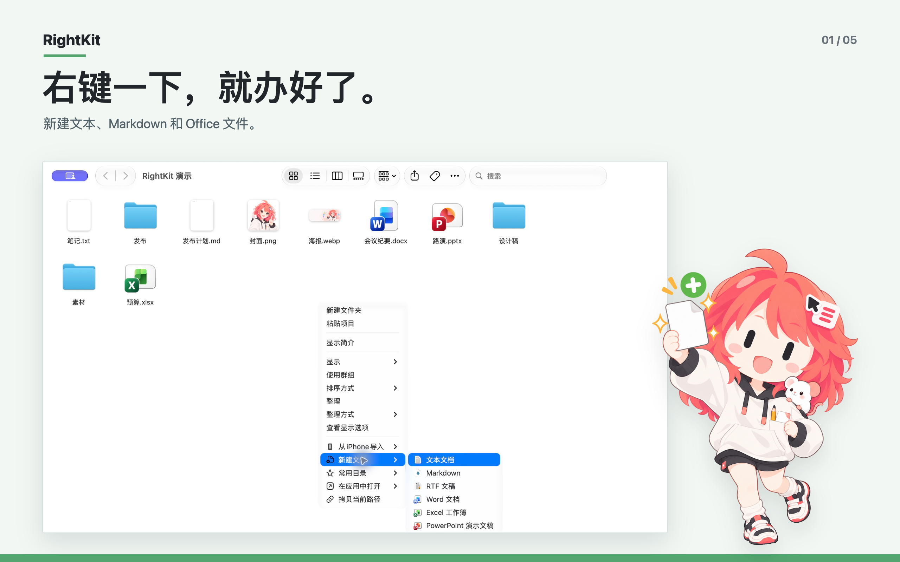
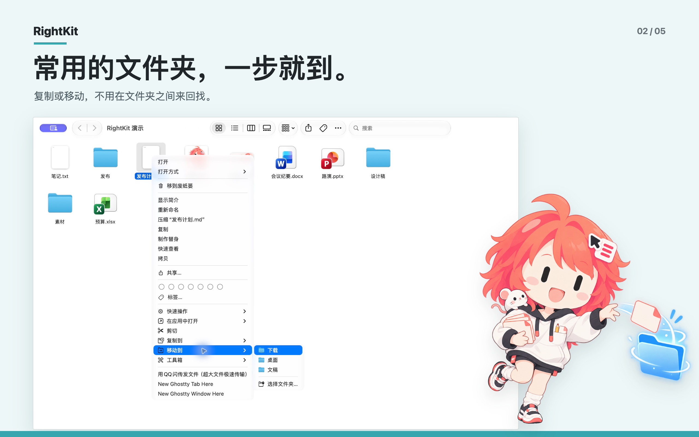
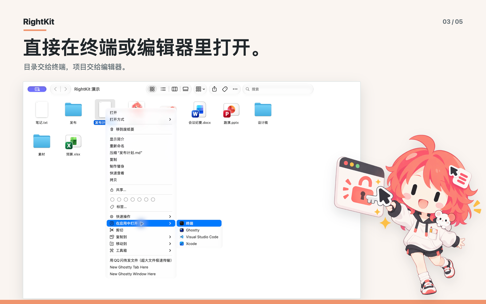
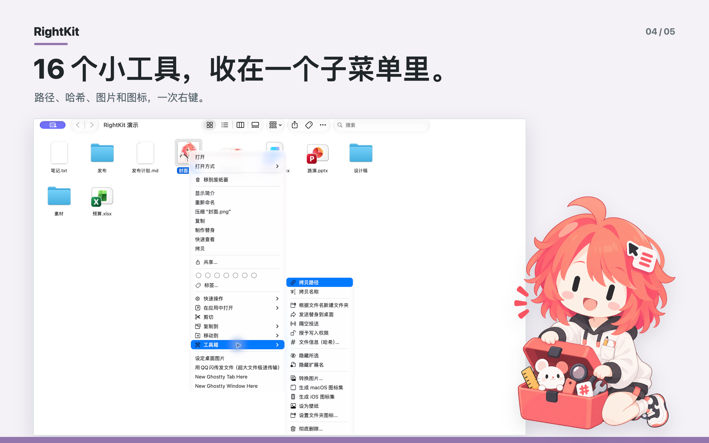
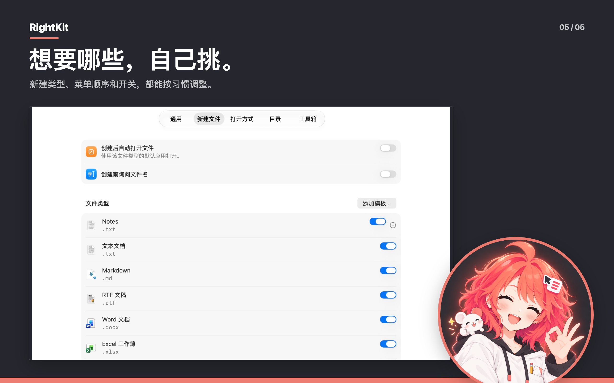

<div align="center">


# RightKit

**macOS 访达的高效右键工具箱。右键一下，就办好了。**

轻量、原生、纯净。基于现代 SwiftUI 与轻量系统扩展打造的访达上下文菜单增强工具。

<p>
  <a href="README.md"><strong>简体中文</strong></a> •
  <a href="README.en.md">English</a> •
  <a href="README.ja.md">日本語</a> •
  <a href="README.ko.md">한국어</a>
</p>

[](https://rightkit.yiliang.app)
[](https://swift.org)
[](https://apps.apple.com/app/id6816212746)
[](https://github.com/AquaHydro/rightkit/releases/latest)
[](LICENSE)
[](docs/technical.md)

[官方网站](https://rightkit.yiliang.app) · [App Store 购买](https://apps.apple.com/app/id6816212746) · [下载官网版 DMG](https://github.com/AquaHydro/rightkit/releases/latest) · [功能规格](docs/features.md) · [设计规范](DESIGN.md) · [工程边界](docs/technical.md)

</div>

---

<p align="center">
  
</p>

## 💡 为什么选择 RightKit？

macOS 的访达（Finder）简洁克制，但在日常高频操作中常常需要绕远路：新建一份文本或表格需要先启动应用、打开终端要一路 `cd` 路径、整理文件需要反复并排开窗口、查看哈希或转换图片要翻找第三方软件。

**RightKit** 将这些常用操作带回了你鼠标右键的方寸之间：

- **纯粹且原生**：界面遵循 Apple 人机交互规范与系统设计语言，没有任何多余的材质与花哨堆砌，和访达融为一体。
- **毫秒级响应**：轻量级架构设计，主程序与 Finder 扩展各司其职，采用启动预热与位图缓存机制，右键呼出丝滑无卡顿。
- **智能上下文匹配**：依据所选目标类型（空白处、单一文件、目录集合、图片文件）动态组装菜单，不展示无用命令，不污染右键菜单。
- **沙盒安全与零数据收集**：严格运行于 App Sandbox 沙盒环境，仅访问你显式授权的监视目录；全部文件操作均在本机完成，无任何联网追踪与数据收集。
- **关键路径防误删保护**：彻底删除操作提供二次确认保护，并对系统核心目录及个人主目录提供原生安全防线。

---

## ✨ 核心功能

### 1. 新建文件 (New File)

在哪里右键，就在哪里建立新文档。

- **12 种内置类型**：纯文本（.txt）、Markdown（.md）、富文本（.rtf）、Word（.docx）、Excel（.xlsx）、PowerPoint（.pptx）、JSON、XML、HTML、CSS、JavaScript、Shell 脚本（.sh）。
- **自定义个人模板**：把常用文档或配置拖入模板库，RightKit 会完整保存副本并在创建时原样克隆。
- **重名自动顺延**：目标文件夹已存在同名项目时自动编号（如 `未命名 2.docx`），从不覆盖已有文件。
- **按需偏好设置**：可设置「创建前询问文件名」或「创建后自动用默认应用打开」。

<p align="center">
  
</p>

### 2. 剪切、快速复制与移动 (Cut, Copy & Move)

解决 macOS 访达缺乏直观右键剪切与快速移动目标的痛点。

- **右键剪切与粘贴**：右键选定项目执行「剪切」，在目标目录右键「粘贴」即可完成移动。队列独立管理，不干扰系统剪贴板。
- **发送到目标列表**：将高频使用的归档目录配置到「发送到」，在右键子菜单中一步完成复制或移动。
- **常用目录一键跳转**：在空白处右键可直接打开预设的常用文件夹。
- **原生耗时进度指示**：传输大文件或大量项目超过 1 秒时自动展现原生进度条，支持安全随时取消。

<p align="center">
  
</p>

### 3. 在应用中打开 (Open in App)

专为开发者、设计师和重度效率用户优化。

- **上下文智能识别**：选择普通文件时，编辑器打开文件本身；选择文件夹时，终端直接以该目录为工作路径启动。
- **自动检测常用工具**：自动检测系统内安装的终端（Terminal）、Ghostty、Visual Studio Code 与 Xcode，也能手动添加任意外部 `.app`。
- **纯净安全调用**：直接通过系统 Workspace API 调度，不进行任何易受注入攻击的 Shell 字符串拼接。

<p align="center">
  
</p>

### 4. 实用文件工具箱 (Toolbox)

16 个实用文件管理与开发辅助命令，可在设置中自由开关并按组拖动排序：

| 分组 | 命令功能 | 说明 |
| --- | --- | --- |
| **基础信息** | 拷贝路径、拷贝名称 | 复制选中项的 POSIX 路径或显示名称；空白处可直接「拷贝当前路径」 |
| **快速整理** | 根据文件名新建文件夹 | 以文件名创建同名文件夹并将该文件移入其中，快速整理杂乱目录 |
| | 发送替身到桌面 | 快速为重要项目在桌面建立替身 |
| | 隔空投送 | 调起系统原生隔空投送面板一键分享全部所选项 |
| | 授予写入权限 | 为所选项目赋予当前用户的读写权限（不改动所有者、不递归） |
| | 文件信息（哈希） | 本地流式计算 MD5、SHA-1、SHA-256、SHA-512，支持一键拷贝 |
| **文件显示** | 隐藏或显示所选 | 快捷切换文件的隐藏标志位（无需敲命令行） |
| | 隐藏或显示扩展名 | 切换文件的扩展名显示状态 |
| **图像与图标** | 转换图片 | 在源文件旁快速转换为 PNG、JPEG、HEIC 或 TIFF 格式 |
| | 生成 macOS 图标集 | 一键生成包含各点位尺寸的 `.iconset` 与标准 `.icns` 图标文件 |
| | 生成 iOS 图标集 | 自动导出包含 13 个主流分辨率的 App 图标文件夹 |
| | 设为壁纸、设置文件夹图标 | 一键将选定图像设为桌面壁纸，或为所选文件夹自定义个性图标 |
| **安全处置** | 解散文件夹 | 将目录内的直接子项提升至父级，并把空文件夹移入废纸篓 |
| | 彻底删除 | 绕过废纸篓直接移除项目，默认开启防误触确认与系统核心目录保护 |

<p align="center">
  
</p>

### 5. 更多系统集成 (System Integration)

- **快捷指令（Shortcuts）与聚焦（Spotlight）**：将新建文件、哈希计算、图片转换、图标生成、二维码生成等核心动作暴露给系统自动化。
- **系统服务（Services）**：
  - **离线二维码**：选中文本即可在本机离线生成高清二维码，支持保存为 PNG 或拷贝图像。
  - **网页翻译**：选中文本一键调用 Google 翻译或百度翻译。
- **全界面国际化**：内置简体中文、English、日本語、한국어 四种语言，随系统自动匹配或在设置中手动切换。

---

## 📥 获取与安装

RightKit 同一份代码维护两个发布渠道，两者的核心功能完全一致：

| 项目 | Mac App Store（商店版） | 官网版（GitHub Release） |
| --- | --- | --- |
| **获取途径** | [Mac App Store 购买下载](https://apps.apple.com/app/id6816212746) | [GitHub Release 免费下载 DMG](https://github.com/AquaHydro/rightkit/releases/latest) |
| **适用人群** | 偏好 App Store 统一管理、希望支持独立开发者 | 偏好本地离线安装、通过 DMG 直接分发 |
| **功能体验** | 完整功能 | 完整功能 |
| **版本更新** | 由 App Store 自动管理并静默推送更新 | 应用内自动检查 GitHub 最新 Release 并跳转下载 |
| **安全沙盒** | 启用 App Sandbox | 启用 App Sandbox |

### 首次启用说明

由于 macOS 的安全机制，首次安装后请完成两步初始设置：

1. **授权监视目录**：打开 RightKit 主程序，在欢迎窗口或「通用」设置页中点击「授权访问个人文件夹」（推荐授权个人主文件夹）。RightKit 仅在授权过的文件夹内展现上下文菜单。
2. **启用访达扩展**：前往「系统设置 → 通用 → 登录项与扩展」，在「访达扩展」列表中找到并勾选启用 RightKit。

主程序的「通用」设置页提供了直观的扩展状态检测卡片（包括「已启用」、「未运行」、「后台服务已关闭」与「未启用」），并提供一键跳转系统设置或重启访达的快捷指引。

<p align="center">
  
</p>

---

## 🛡️ 隐私与安全准则

1. **严格的 App Sandbox 限制**：主程序与扩展均受沙盒约束，网络访问权限按渠道严格最小化（商店版无网络权限，官网版仅在检查更新时向 GitHub 接口发起只读查询）。
2. **Security-Scoped Bookmarks 机制**：应用对文件夹的访问全部依赖 macOS 标准的安全作用域书签，用户没有授权的外部路径一律无法触碰。
3. **关键系统路径防删保护**：根目录 `/`、当前用户主目录以及 `/System`、`/Library`、`/usr` 等系统核心目录受强行保护，彻底删除命令坚决拒绝处理这些位置。
4. **零追踪与零分析**：不包含任何第三方 SDK、统计代码或追踪探针，不记录用户操作的文件路径与文件名。

---

## 🛠️ 架构与工程设计

工程划分为清晰的四个 Target：

```text
RightKit (Workspace)
├── RightKit          # SwiftUI 主程序：承载设置界面、欢迎窗口、二次确认弹窗、文件 I/O 调度、App Intents 与系统服务
├── RightKitFinder    # 轻量 Finder Sync Extension：读取监视目录，毫秒级组装上下文菜单，将命令分派给主程序
├── RightKitAgent     # LaunchAgent 守护进程：持有 App Group XPC 服务，确保扩展指令稳定拉起主程序
└── RightKitCore      # 纯 Swift 逻辑包：纯数据模型、规则引擎、保护路径判定与重命名计算，无外部依赖，100% 单元测试覆盖
```

### 扩展性能优化

Finder Sync 扩展极易导致访达掉帧或彩虹轮。RightKit 在工程实现中进行了严谨的调优：
- **菜单构建隔离**：不在菜单回调中进行任何读写文件、哈希计算或高开销 I/O。
- **预热机制**：扩展启动及设置变更后自动在后台预热菜单结构，提前连接系统图标服务，避免初次右键等待。
- **位图优化**：跨进程向访达提交的图标均规范为 16 pt 的 2x 单尺寸位图，避免系统多分辨率位图编码带来的额外传输延迟。

---

## 🔨 本地构建与开发

### 环境要求

- macOS 26 或更高版本
- Xcode 27 或更高版本
- [XcodeGen](https://github.com/yonaskolb/XcodeGen)（工程配置维护于 `project.yml`）

### 常用 Make 命令

```sh
# 生成 Xcode 工程、运行完整测试集、构建双渠道，并执行规范校验
make verify

# 构建 Debug 版本并立即启动主程序
make run

# 编译官网版（Developer ID 签名、Apple 公证并打包 DMG，输出至 .build/release/）
make release

# 编译商店版（归档、导出 .pkg 并执行包体校验，输出至 .build/release-appstore/）
make release-appstore

# 上传商店版至 App Store Connect
make upload-appstore
```

### 核心设计与规范文档

在阅读和提交代码前，请先查阅以下规范文档：

- [功能规格 (docs/features.md)](docs/features.md)：全部功能的行为约定、默认值、菜单显示规则与错误处理。
- [设计规范 (DESIGN.md)](DESIGN.md)：颜色、排版、组件规格与视觉一致性约束。
- [工程边界 (docs/technical.md)](docs/technical.md)：进程划分、App Group 通信、沙盒权限与发布流水线。
- [验收标准 (docs/verification.md)](docs/verification.md)：功能验证点与测试用例清单。
- [实现顺序 (docs/roadmap.md)](docs/roadmap.md)：工程路线图与里程碑。

在修改文档后，可运行脚本检验文档完整性与链接：

```sh
python3 scripts/check_docs.py
```

---

## 🎬 官方音乐动画 MV: 《Under the Right Click》

为了诠释 RightKit 的设计理念与核心隐喻，我们为品牌吉祥物 Riko 制作了一部专属的 90 年代动画风格音乐 MV：《Under the Right Click · 右クリックの向こう》（全长 3 分 28 秒，170 BPM J-rock 动画 OP）。

<p align="center">
  <a href="https://www.bilibili.com/video/BV1XnpK6aEut" target="_blank" rel="noopener noreferrer">
    
  </a>
</p>

### 故事与隐喻：失序档案城

> 「指尖悬在半空，光标亮起；三条横线，我只相信它们。3、2、1……右键！打开世界的背面。」

故事设定在一个由无数文件柜堆叠而成的「失序档案城」。当突如其来的「熵潮」摧毁高楼、文件像雪花般散落失去路径与名称时，档案整理者 **Riko** 唤醒了指尖的右键能力：伴随「新建、拷贝、移动」的层层菜单展开，混乱的碎片重回原位，城市的熵值最终归零，迎接黎明。

这是对 RightKit 的浪漫隐喻：无论日常的文件多乱、路径多深，只要点下右键，一切都能恢复井然有序。

### 独特的 riso-cel 视觉重绘管线

MV 的全套渲染管线代码已在仓库中开源：
- **纯代码着色器重绘**：通过 WebGL 着色器（Kuwahara 降噪、XDoG 动态描边、45° 网点叠印与纸张纤维质感），将画面统一重绘为带有孔版印刷（Risograph）质感的 90 年代赛璐璐风格。
- **渲染引擎开源**：位于 [`mv/under-the-right-click/`](mv/under-the-right-click/README.md)，包含无头浏览器逐帧渲染脚本、歌词卡点时间轴与完整的[逐镜头分镜表](mv/under-the-right-click/STORYBOARD.md)。

<p align="center">
  
</p>

---

## 🎨 品牌形象与素材授权

RightKit 的品牌吉祥物是 **Riko**，一位开朗、手快、留着珊瑚色发尾与呆毛、佩戴光标菜单发卡的小帮手。

- **源代码与文档**：基于 [MIT 许可证](LICENSE) 开源。
- **原创品牌资产保护**：RightKit 名称、Riko 角色形象、应用图标、菜单栏图标、原创插画、动画、MV 视频及宣传物料均保留所有权利，详见 [素材授权说明 (ASSETS.md)](ASSETS.md) 与 [MV 许可说明 (mv/under-the-right-click/NOTICE.md)](mv/under-the-right-click/NOTICE.md)。开源项目代码不代表授予品牌资产与美术素材的二次商业使用或许可。
- **第三方图标与资源**：详见 [第三方资源与许可 (THIRD_PARTY_NOTICES.md)](THIRD_PARTY_NOTICES.md) 与 [应用图标来源记录 (website/assets/apps/SOURCES.md)](website/assets/apps/SOURCES.md)。

---

## 💬 反馈与社区

- **提交 Issue**：欢迎在 [GitHub Issues](https://github.com/AquaHydro/rightkit/issues) 反馈 Bug 或提出新功能构想。
- **支持与商务**：联系邮箱 `contact@yiliang.me`。
- **开发者**：由 [氢氧根 (Liao Yiliang)](https://rightkit.yiliang.app) 独立设计与开发。
